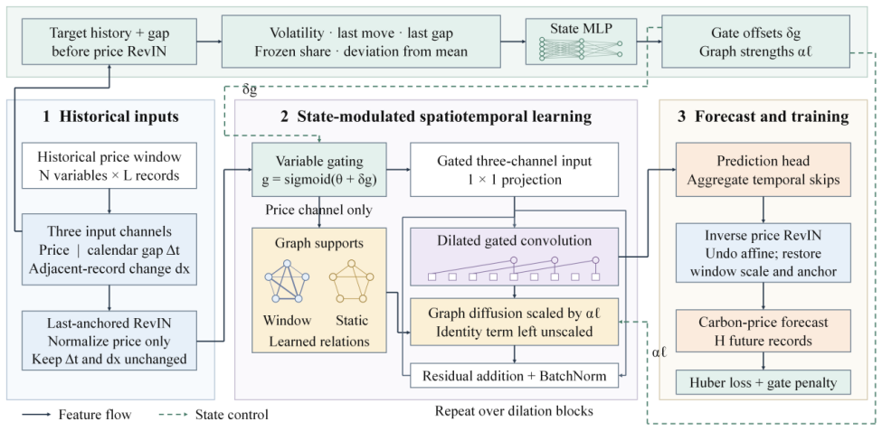

# RADL

RADL is a state-modulated spatiotemporal model for carbon price forecasting.



## Contents

- `forecast/`: RADL forecasting model and training code.
- `dependency/`: CUTS+ predictive-dependency analysis. CUTS+ is separate from RADL and is distributed under its [MIT license](dependency/LICENSE-CUTS-PLUS.txt).

## Getting started

Install the packages in `requirements.txt`, then run from `forecast/`:

```bash
python RADL.py -data_path PATH_TO_INPUT.csv
```

The input must contain a date/index column followed by numeric columns: the target market first, then 15 predictors. The proprietary Wind data are not included and require authorized access.

For dependency analysis, run from `dependency/`:

```bash
python run_markets.py --data-dir PATH_TO_DATA --output PATH_TO_OUTPUT
```

The dependency-analysis runner requires a CUDA-enabled PyTorch installation and a supported GPU.

## Reproducibility

Raw data, trained weights, results, and some analysis scripts are not included. Check the configuration and experiment records before attempting to reproduce manuscript results; the supplied code and manuscript differ in the Huber threshold for multi-step forecasts and early-stopping patience.
